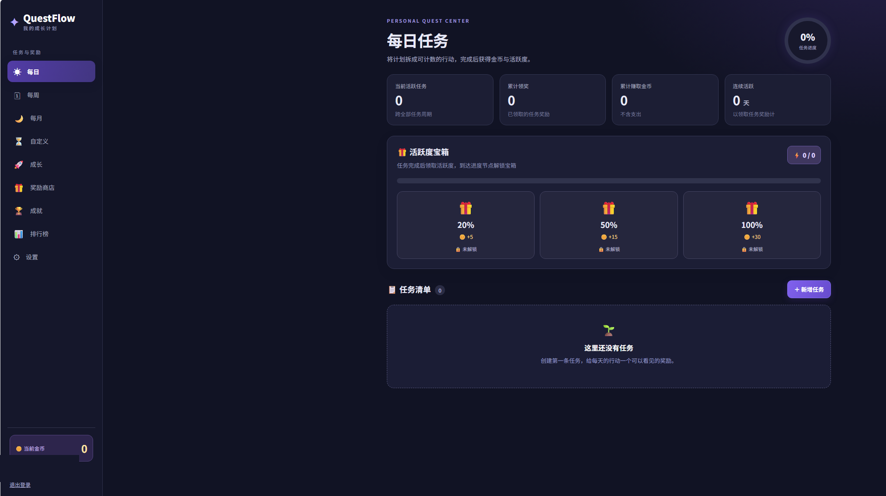

# PAL · Personal Activity Level

**轻量、自托管、游戏化的个人计划与活跃度奖励系统。** 运行在 Docker / SQLite 上，为 PC、Android 和 iOS 的浏览器设计。无需 MySQL、Redis、Node.js 或额外 Python 第三方包。

> PAL 是原 QuestFlow v0.1 的改名与浅色界面版本。保留原有任务奖励逻辑、SQLite 数据库文件名和 Compose 卷兼容性。



*上图为用户提供的 v0.1 实际运行截图；为避免泄露局域网信息，已裁去浏览器地址栏并遮盖账户区域。新版采用浅色柔和背景，功能布局保持一致。*

## 功能 Features

- **每日、每周、每月及自定义周期任务**，另有长期成长任务。
- 目标计数（如 0/10），完成后领取金币与活跃度；各周期独立计算。
- 完成度 **20% / 50% / 100%** 的阶段宝箱，允许分别领奖。百分比按已领取活跃度 / 当前启用任务的全部活跃度计算。
- 金币余额与收支账本、自定义兑换奖励商店。
- 成就系统、个人历史周/月活跃度排行榜（非多人排行）。
- 单人管理员登录、CSRF 防护、SQLite 在线一致性备份、无外部云依赖。

## 安装：Docker Compose（fnOS / Linux NAS）

```bash
# 将解压后的项目置于自己的固定目录并进入该目录
cd /path/to/pal
cp .env.example .env
# 编辑 .env，将 APP_SETUP_KEY 改成你自己生成的随机值
sudo docker compose up -d --build
sudo docker compose ps
```

在同一局域网打开 `http://<NAS_IP>:8765`，首次登录使用 `.env` 里的安装密钥创建管理员。默认时区为 `Asia/Shanghai`。请勿直接将该端口暴露到公网。

**fnOS 用户遇到镜像 401、apk 超时、文件权限及 Docker socket 权限问题？** 请直接阅读 [fnOS 安装与故障处理](INSTALL-FNOS.md)，里面已经记录和解决了实际部署中遇到的四类问题。

## 保持旧版数据不丢失

本版更改的是用户界面品牌，未改变数据库结构。为兼容旧部署，`docker-compose.yml` 仍使用 `name: questflow` 和 `questflow_data`，容器名仍是 `questflow`；SQLite 数据库文件名仍为 `questflow.db`。升级前请按 [数据库与备份](DATABASE.md) 做备份。不要使用 `docker compose down -v`。更换 Compose project name 或宿主机卷路径前务必确认原卷。

## 数据与安全

SQLite 位于 Docker 卷 `/data/questflow.db`。使用自带的脚本进行一致性备份：

```bash
sudo docker exec questflow python /app/backup.py /data/backups/pal-backup.db
sudo docker cp questflow:/data/backups/pal-backup.db ./pal-backup.db
```

请将备份放到其他设备。数据库、`.env`、密码、私有日志不能提交到 GitHub。完整说明见 [DATABASE.md](DATABASE.md) 和 [SECURITY.md](SECURITY.md)。本项目是个人 NAS 原型，**没有完成独立安全审计**，只建议在可信局域网/VPN 内使用。

## 目录结构

```text
.
├── app.py                  # Python HTTP 服务 / SQLite / 奖励逻辑
├── backup.py               # SQLite backup API 一致性备份
├── test_e2e.py             # 端到端功能回归测试
├── static/
│   ├── style.css           # 响应式网页和柔和浅色主题
│   ├── app.js              # 小型前端交互
│   └── icon.svg            # 应用图标
├── manifest.webmanifest    # PWA 网页应用元信息
├── docs/images/            # 实际运行截图
├── Dockerfile              # 单镜像，无额外数据库服务
├── docker-compose.yml      # Docker Compose
├── .env.example            # 安装配置模板（复制为 .env 后修改）
├── .gitignore
├── .dockerignore
├── INSTALL-FNOS.md          # 安装和常见故障
├── DATABASE.md              # 持久化/迁移/备份
├── SECURITY.md              # 安全边界和风险
├── CHANGELOG.md             # 版本说明
└── LICENSE                  # MIT
```

## 本地开发与测试

需要 Python 3.12+，运行时不使用第三方 Python 包。执行 `python test_e2e.py`，测试在临时目录中启动独立的本地服务，不触及真实 NAS 数据卷。正式部署前可手动确认 PC/手机页面显示。

## 开源

MIT License。可自由学习、修改、再发布，保留许可声明即可。Issues、Pull Requests 和建议欢迎提交。当前优先保持简单、可移植和适合低功耗自托管环境。